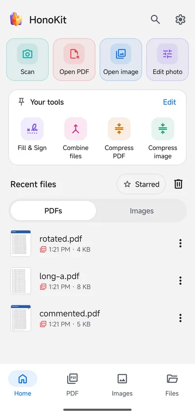
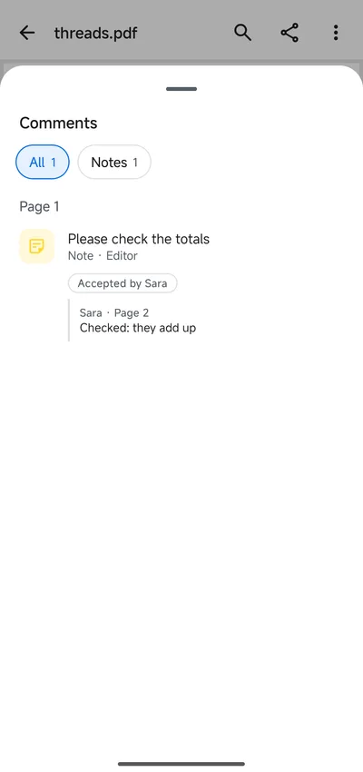
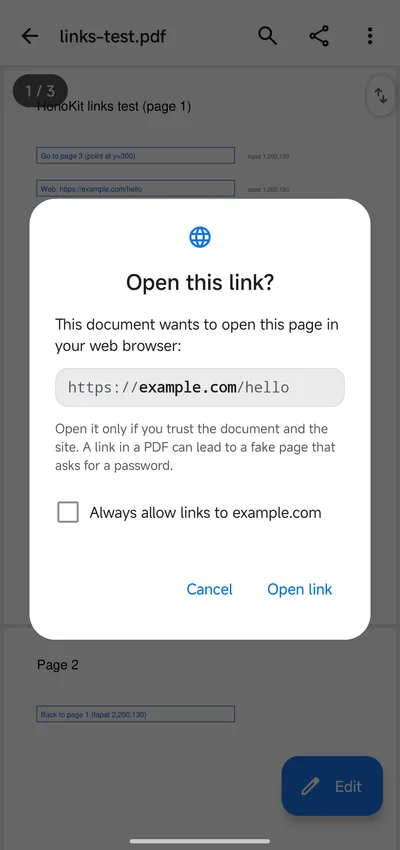
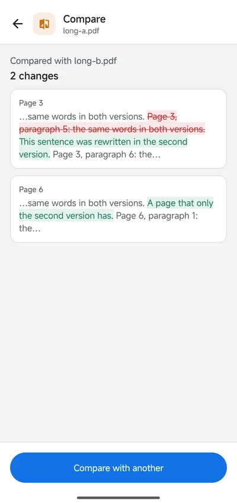
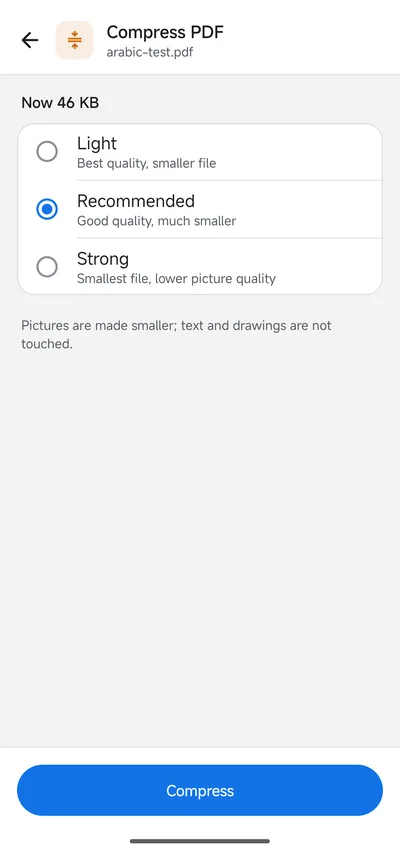
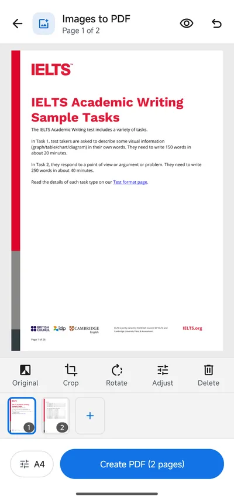

<p align="center">
  
</p>

<h1 align="center">HonoKit for Android</h1>

<p align="center">
  An offline PDF and image toolkit for Android, with first-class Arabic and right-to-left support.
</p>

<p align="center">
  <a href="https://github.com/abd-el-rahman-mustafa/HonoKit-Android/releases/latest">Download</a> ·
  <a href="https://github.com/abd-el-rahman-mustafa/HonoKit">HonoKit for Windows</a> ·
  <a href="https://github.com/abd-el-rahman-mustafa/HonoKit-Android/issues">Report a problem</a> ·
  <a href="LICENSE">AGPL-3.0</a>
</p>

<p align="center">
  
  
  
</p>
<p align="center">
  
  
  
</p>

## Why HonoKit

- **Offline.** Your files never leave the phone. No account, no ads, no tracking, no telemetry.
  The only connection is an optional update check against the public releases page.
- **Arabic and right-to-left first.** Full mirroring, correct Arabic search, selection and copying
  in reading order, Arabic shaped in everything you add (text, stamps, signatures, form fields).
- **English and Arabic**, light and dark themes, large text and screen readers supported.

## Features

**PDF**
- Viewer: continuous pages, pinch zoom, thumbnails, bookmarks, links (asks before leaving the
  app), search that understands Arabic, select and copy, night mode, password-protected files.
- Edit text (a paragraph at a time), add text, edit pictures, erase areas for real.
- Comment: highlight, underline, strike-through, pen, sticky notes, shapes, text boxes, stamps,
  and a comments list that shows replies under their comment.
- Sign: draw, type (Latin and Arabic handwriting styles) or photograph your signature.
- Fill in forms: text, check boxes, radio buttons and lists.
- Organize: rotate, delete, reorder, duplicate, extract, insert pages; crop pages.
- Combine, split, compress, protect / unlock, watermark, page numbers, compare two PDFs,
  PDF to JPG/PNG, PDF to text.
- Scan: live page detection and auto capture, cleaned-up looks, ID cards and books, and text
  recognition (OCR) so scans can be searched and copied.

**Images**
- Photo editor: adjust, filters, crop, rotate, text, stickers, drawing, frames.
- Compress, resize, crop, convert (JPEG, PNG, WebP, HEIC, AVIF…), rotate, watermark, image info
  (remove location and camera details).
- On-device AI (64-bit phones): upscale, remove background, blur faces.

Android 8.0 (API 26) or newer.

## Download

Get the signed APK from the [latest release](https://github.com/abd-el-rahman-mustafa/HonoKit-Android/releases/latest)
and open it on your phone. Installed copies update themselves from this repository's releases
(Settings › Updates). Looking for the Windows app? See
[HonoKit for Windows](https://github.com/abd-el-rahman-mustafa/HonoKit).

## Build

You need **JDK 21** and the **Android SDK** (platform 37, build tools). The project is Kotlin
with Jetpack Compose; MuPDF is used only inside the `:engine` module.

```bash
# any OS
export JAVA_HOME=/path/to/jdk-21
export ANDROID_HOME=/path/to/android-sdk
./gradlew :engine:testDebugUnitTest :app:testDebugUnitTest   # JVM tests
./gradlew :app:assembleDebug                                 # debug APK (com.aamus.honokit.dev)
```

On Windows, `gw.cmd <task…>` runs Gradle with `JAVA_HOME`, `ANDROID_HOME` and a short temp
folder (`HONOKIT_TMP`, default `.\tmp`); put machine-specific values in `gw.local.cmd` (not in
git). `build-apk.cmd` builds a release APK into `release\`; a release build is signed only when a
keystore is supplied: a `keystore.properties` (`storeFile`, `storePassword`, `keyAlias`,
`keyPassword`) named by `POWERPDF_KEYSTORE_PROPERTIES`, or at
`~/.android-keys/powerpdf/keystore.properties`. Never commit a keystore.

| Module | What it holds |
| --- | --- |
| `app` | Screens (Compose), documents, tools, settings, updates |
| `engine` | Everything that touches MuPDF: reading, drawing, editing, saving |
| `ocr` | Text recognition, page finding and the image AI models (onnxruntime) |

The code namespace is still `com.aamus.powerpdf` (the project's working name); the app ID is
`com.aamus.honokit`.

## Contributing

Issues and pull requests are welcome, in English or Arabic.

1. Open an [issue](https://github.com/abd-el-rahman-mustafa/HonoKit-Android/issues) for a bug or
   an idea (Settings › About › Report a problem fills in your version and phone model).
2. Fork the repository, create a branch, make your change with tests, and open a pull request.

See [CONTRIBUTING.md](CONTRIBUTING.md). Security problems: please report them privately, see
[SECURITY.md](SECURITY.md).

## License

HonoKit is free software under the [GNU Affero General Public License 3.0](LICENSE), because it
is built on [MuPDF](https://mupdf.com) (AGPL-3.0). Fonts and libraries keep their own licences,
listed in the app under Settings › About › Open-source licences.
